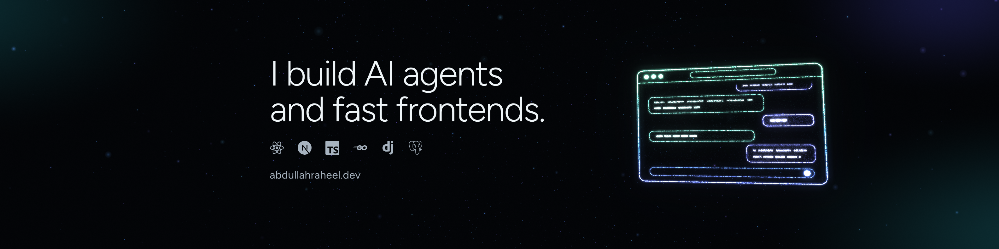

  <a href="https://abdullahraheel.dev/"><strong>Portfolio</strong></a>
  ·
  <a href="https://www.linkedin.com/in/abdullah-raheel/">LinkedIn</a>
  ·
  <a href="mailto:abdullaharaheel@gmail.com">Email</a>

I'm Abdullah Raheel, a senior software engineer at [Covent](https://getcovent.com/), where I lead a team of three and build our AI agents. Before that, [Metal](https://www.metal.so/) (YC W23).

## At Covent

**Sam buys. Alex sells. Nora coordinates.** Polaris is the AI agent platform I lead. Three agents run over SMS, email and Slack, and every message is checked before it sends. I own the backend (Django, PostgreSQL, Celery and Redis on AWS) and the Next.js operator app. 20K messages a day go through it today.

**Every inbound text lands.** I rebuilt GoHighLevel webhook intake as a serverless pipeline (API Gateway, Lambda, SQS and S3), and delivery rose from 49% to 99.8% within three days.

**Covent MCP, written in Go.** I proposed it and led it to production. 23 read-only tools let Claude, ChatGPT, Codex and Cursor read Covent's data safely, with OAuth 2.0 and PKCE.

**A new frontend, zero downtime.** I moved Covent from Create React App to Next.js while customers kept working in it every day. 170 locations moved over without an outage, with 765 people working in it at the same time, and our heaviest page loads 40% less JavaScript up front.

**Search a city by drawing on it.** I rebuilt Investor Prospecting on Mapbox WebGL with live property data. Writing a message only for a buyer you pick cut AI calls by 96% and AI spend from $9,000 to $700 a month.

## Before Covent

**Metal (YC W23)**, fullstack engineer, 2024 to 2025. I shipped the DataOps portal in 20 days and built a versioned pipeline for 2M+ records that cut upstream errors by 80%.

**Bleed AI**, software engineer, 2023 to 2024. I built UpAutomate, which scores Upwork jobs with an LLM, and took it to 150 trial users.

**Workforce Software**, software engineer, 2022 to 2023. Time and attendance systems for Canon, Ornge and National Gypsum.

## Stack

**Backend and data**

  
  
  
  
  
  

**Product engineering**

  
  
  
  
  
  

**Delivery and quality**

  
  
  
  
  
  
  

